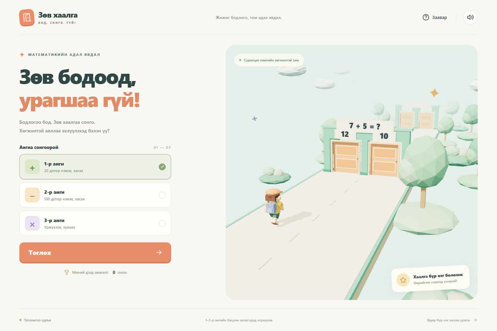

# Зөв хаалга

Бага ангийн хүүхдэд зориулсан монгол хэлтэй 3D математикийн гүйлтийн тоглоом. TypeScript + Three.js + Vite. Бүх дүр, орчин, дууг кодоор бүтээсэн; төлбөртэй зураг, загвар, дуу ашиглаагүй.

**[Шууд тоглох →](https://b232270091.github.io/zuv-khaalga/)** · [Эх код](https://github.com/B232270091/zuv-khaalga)



## GitHub Pages

`main` салбарын шинэчлэлт бүрд `.github/workflows/deploy.yml` автоматаар хамааралтай сангуудыг суулгаж, логикийн тест ажиллуулж, тоглоомыг бүтээн GitHub Pages-д нийтэлнэ. Repository-ийн **Settings → Pages → Source** тохиргоо **GitHub Actions** байна.

`vite.config.ts`-ийн `base: './'` тохиргоо нь repository-ийн дэд замд JavaScript, CSS, favicon зөв ачаалагдахыг хангана. Браузерт Node.js суулгах шаардлагагүй; нийтэлсэн холбоосоор шууд тоглоно.

## Ажиллуулах

**Энэ Windows компьютерт:** `start-game.cmd` файлыг хоёр дарж нээгээд, терминалд гарсан `http://localhost:5173` холбоосоор орно. Эсвэл:

```powershell
powershell -NoProfile -ExecutionPolicy Bypass -File .\run.ps1
```

Төслийн `.tools` хавтас дахь Node.js-ийг автоматаар ашиглана. Компьютерийн Node.js болон PATH тохиргоог өөрчлөхгүй.

**Node.js суулгасан бусад компьютерт:** Node.js 22.12+ шаардлагатай. [Vite-ийн албан ёсны заавар](https://vite.dev/guide/).

```sh
npm ci
npm run dev
```

Утас/таблетыг ижил Wi-Fi-д холбоод Vite терминалд харагдах `Network` хаягаар орно. Браузер WebGL 2 дэмждэг, графикийн хурдатгал асаалттай байх шаардлагатай.

## Удирдлага

- `←` / `A` — зүүн хаалга; `→` / `D` — баруун хаалга.
- Гар утас: зүүн/баруун тийш шудрах, эсвэл доод хоёр том товч.
- `P` / `Esc` — түр зогсоох, үргэлжлүүлэх.
- Шар шугам дээр сонголт түгжинэ. Зөв хаалга нээгдэж, бүтэн нэвтэрсний дараа нэг оноо нэмэгдэнэ.
- Буруу сонговол дүр зөөлөн унаж, зөв хариуг тайлбарлах дэлгэц гарна.
- Өөр таб/цонх руу шилжихэд автоматаар түр зогсоно.
- Дээд амжилтыг анги тус бүрээр браузерт хадгална. Дууг толгой хэсгийн товчоор асааж/унтраана.

## Гол тохиргоо

`src/config.ts` дотор тоглолтын тоон тохиргоонууд төвлөрсөн.

| Тохиргоо | Утга | Үүрэг |
|---|---:|---|
| `baseSpeed` | 4.8 | Эхний хурд, нэгж/секунд |
| `speedStepSeconds` | 20 | Хурд нэмэгдэх хугацаа |
| `speedStep` | 0.08 | Эхний хурдны 8%-ийн нэмэгдэл |
| `maxSpeedMultiplier` | 1.8 | Хурдны дээд хязгаар |
| `revealDistance` | 42.18 | Бодлого харагдаж эхлэх зай |
| `decisionDistance` | 5.7 | Сонголт түгжих шугам |
| `wallSpacing` | 43.5 | Хануудын хоорондох зай |
| `doorOpenSeconds` | 0.36 | Хаалга нээгдэх хугацаа |
| `laneSmoothing` | 17 | Эгнээ солих зөөлрүүлэлт |
| `maxPixelRatio` | 1.8 | Дүрслэлийн нягтралын хязгаар |

Эхний бодох хугацаа `(42.18 − 5.7) / 4.8 = 7.6` секунд. Дээд хурданд 4.22 секунд; дараагийн хананд шилжих мөчийг тооцсон ч 4 секундээс их. Хаалга нээгдэх 0.36 секунд нь дээд хурданд түгжих шугамаас мөргөлдөх хүртэлх хугацаанаас бага.

- `src/questions.ts` — ангийн бодлого, ойролцоо буруу хариу, санамсаргүй байрлал.
- `src/engine.ts` — тоглоомын төлөв, тогтмол алхамтай симуляц, түгжилт, мөргөлдөөн, оноо.
- `src/world.ts` — low-poly орчин, дүрийн хөдөлгөөн, дахин ашиглах 3 хана, 28 гэрлийн ширхэг.
- `src/main.ts`, `src/style.css` — монгол интерфэйс, компьютер/мэдрэгчийн удирдлага.
- `src/audio.ts` — Web Audio-гаар үүсгэсэн ая, дууны эффект.

## Шалгах, бүтээх

```sh
npm test
npm run build
npm run test:browser
npm run preview
```

Энэ компьютерт `powershell -NoProfile -ExecutionPolicy Bypass -File .\run.ps1 -Task test` гэх мэтээр ажиллуулж болно.

Автомат шалгалтууд: анги тус бүрийн 10,000 бодлого; зөв/буруу хаалга; хаалга нээгдэх дараалал; нэг удаагийн оноо; өндөр хурдны мөргөлдөөн; 30/60/144 FPS; түр зогсоох/үргэлжлүүлэх/дахин эхлэх; 10 минутын ханын дахин ашиглалт. Playwright нь Edge дээр компьютер, утасны хэмжээнд интерфэйс ба тоглолтыг шалгана. Edge байхгүй бол `playwright.config.ts`-ийн `channel` тохиргоог өөрчилнө.

`npm run build`-ийн `dist/` хавтсыг статик вэб серверт байршуулж болно. `index.html`-ийг `file://`-аар шууд нээхгүй; HTTP серверээр ажиллуулна.

Хөгжүүлэлтийн горим дахь `window.__gameSnapshot()` нь зөвхөн унших оношилгоо; production build-д байхгүй.
